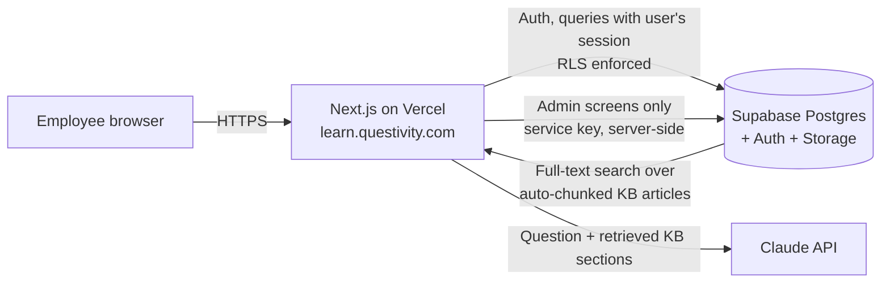

# Questivity Academy

Internal learning platform for **Questivity** employees: an LMS for new-joinee onboarding and
upskilling, a company knowledge base, and **Quest Assistant** — an AI bot that answers questions
from the knowledge base and cites its sources.

Built with **Next.js 15** (App Router, TypeScript, Tailwind), **Supabase** (Postgres, Auth, Storage,
row-level security) and **Claude** (Anthropic API). Deploys to Vercel (or Netlify) on your own domain.

---

## Features

**For employees**
- **My learning** dashboard — assigned courses, due dates, progress, overdue alerts, certificates
- **Course catalog** — search and filter; article, video (upload or YouTube/Vimeo/SharePoint), PDF and quiz lessons
- **Learning paths** — New Joinee Onboarding (auto-assigned on first sign-in), Network Engineer, Cloud & Virtualization
- **Quizzes** graded in the database (answers never reach the browser), pass mark, unlimited retakes
- **Certificates** issued automatically on completion — printable / save as PDF
- **Knowledge base** — categories, full-text search, tags, related articles
- **Quest Assistant** — full-page chat with history + a floating widget on every page; answers only from published
  articles, cites them inline, says "not covered" instead of guessing, thumbs up/down feedback

**For managers**
- **My team** — direct reports' progress and overdue items; assign learning paths with due dates

**For admins**
- **Overview** — completion rate, overdue, certificates, per-course stats, assistant usage
- **Knowledge gaps** — every question the assistant couldn't answer (or got a 👎) → write the missing article
- Course builder (modules, lessons, media upload, quiz editor), learning-path builder, assign paths to departments
- KB editor with markdown preview, draft/published/archived, owner and review dates (overdue reviews highlighted)
- Users (role, department, manager, deactivate, invite), departments, allowed email domains, quiz pass mark

**Security**
- Sign-in restricted to company email domains (enforced in the database), magic link / one-time code, optional Microsoft SSO
- Row-level security on every table; learners can't see others' data, quiz answers, drafts or admin reports
- Managers see only their direct reports; assistant conversations are private to each user
- Private media storage with expiring links; security headers; internal site is `noindex`
- Automated database security tests run in CI

## Architecture



**How the assistant works (RAG):** every time an article is saved, a database trigger splits it into
heading-based sections and indexes them (`kb_chunks`). A question is matched against published sections
with Postgres full-text search; the top sections are sent to Claude with strict instructions to answer
only from them and cite `[n]`. If nothing relevant exists, the answer is marked *not covered* and appears
on the admin **Knowledge gaps** list.

## Project structure

```
src/
  app/
    login/                 sign-in (email link/code, Microsoft SSO), sign-out
    auth/callback/         auth redirect handler
    (app)/                 signed-in area (sidebar shell + floating assistant)
      dashboard/ courses/ paths/ kb/ assistant/ certificates/ team/
      admin/               overview, courses, paths, kb, users, settings (+ server actions)
    api/assistant/         chat + feedback endpoints
  components/              UI, markdown, assistant chat, course cards
  config/brand.ts          names, tagline, assistant name
  lib/                     supabase clients, auth guards, RAG/Claude, helpers
supabase/
  migrations/              schema, business rules, row-level security, storage
  seed.sql                 starter courses, paths and knowledge base
  tests/                   database security & business-rule tests (CI)
public/brand/              logos (placeholders — see BRAND.md)
```

## Getting started (local)

Prerequisites: Node 20+, a Supabase project (free tier is fine to start), an Anthropic API key.

```bash
npm install
cp .env.example .env.local      # fill in the values
npm run dev                     # http://localhost:3000
```

Database setup, auth configuration, first admin and production deployment: **see [DEPLOYMENT.md](DEPLOYMENT.md)**.
Brand colours, fonts and logos: **see [BRAND.md](BRAND.md)**.

## Starter content

`supabase/seed.sql` loads 7 courses (31 lessons, 32 quiz questions), 3 learning paths and 13 knowledge-base
articles tailored to Questivity's business (networking, security, virtualization/cloud, Linux, delivery
process, partner portfolio). Two HR/IT articles are seeded as **drafts with [placeholders]** — complete
and publish them in Admin → Knowledge base. Review all content before go-live.

## Scripts

| Command | What it does |
|---|---|
| `npm run dev` | Local development server |
| `npm run build` / `npm start` | Production build / serve |
| `npm run typecheck` | TypeScript check |
| `npm run lint` | ESLint |
